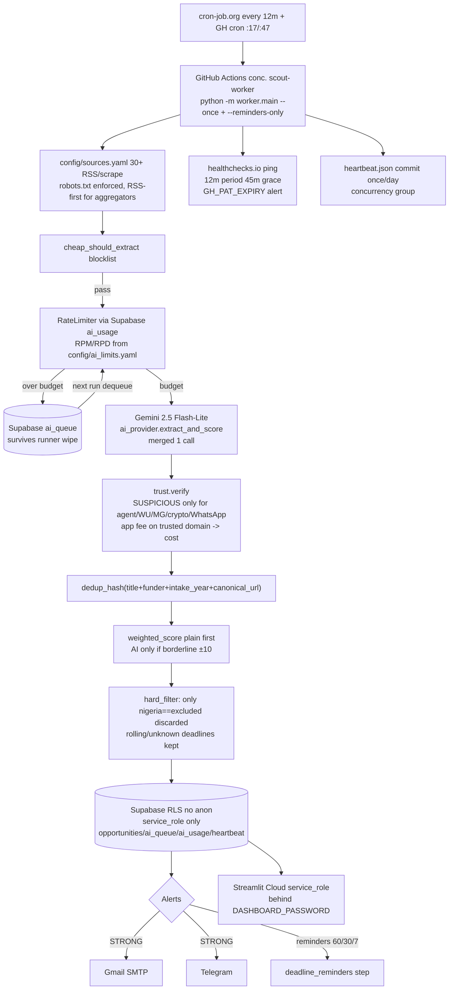

# Opportunity Scout — Handover v2 (2026-11-02)

> For the next engineer or AI picking up this project cold. Covers all review fixes from 2026-11-02.

## 1. What changed in this review (13 fixes)

| # | Requirement | What changed | File(s) |
|---|---|---|---|
| 1 | Queue + counters in Supabase (runners wiped) | Replaced `/tmp/ai_queue.jsonl` + in-memory RPM/RPD with `ai_queue` + `ai_usage` tables. `enqueue_ai/dequeue_ai/get_ai_usage/increment_ai_usage` now persist. Test proves item survives new run. | `supabase/schema.sql`, `worker/db/supabase_client.py`, `worker/utils/rate_limiter.py`, `worker/main.py`, `tests/test_persistence.py` |
| 2 | RLS no anon policies | Removed `allow_all_anon` policies. Enabled RLS with **no** anon policies — `service_role` bypasses RLS, so worker & dashboard (server-side Streamlit) use `SUPABASE_SERVICE_ROLE_KEY` only. Documented server-side safety behind `DASHBOARD_PASSWORD`. | `supabase/schema.sql`, `worker/db/supabase_client.py`, `app/streamlit_app.py`, `.env.example` |
| 3 | healthchecks.io dead-man's switch + GH token expiry | Added `HEALTHCHECKS_PING_URL` ping at end of every run (success → `GET url`, fail → `GET url/fail`). Healthchecks.io check should be Period 12m, Grace 45m — alerts via its own email/Slack/Telegram when pings stop 45m. Added `GH_PAT_EXPIRY` check: warns via email+Telegram when PAT ≤7 days. | `worker/main.py`, `.env.example`, `config/ai_limits.yaml`, `.github/workflows/scout.yml` (passes HEALTHCHECKS_PING_URL) |
| 4 | Real Gemini limits, current model | Verified Nov 2026: 2.0 family shut down 2026-06-01; 2.5 family restricted to pre-existing projects (new projects 404). Default is now `gemini-3.5-flash-lite`, with runtime auto-detection of the models a key can actually see. AI Studio now issues `AQ.Ab...` auth keys. | `worker/extraction/ai_provider.py`, `worker/utils/rate_limiter.py`, `config/ai_limits.yaml`, `.env.example`, `supabase/schema.sql` comments |
| 5 | Verification: SUSPICIOUS only for agent payments | New `SUSPICIOUS_PAYMENT_PATTERNS` only for Western Union/MoneyGram/crypto/gift/WhatsApp payment, `fee to secure/release award`, payment to individual/agent. Official `application fee` on trusted domain → cost breakdown, not SUSPICIOUS. Trusted domain now matches **exact registered domain** via `tldextract`; brand impersonation (chevening, daad, etc. in non-allowlisted domain) flagged as UNVERIFIED. | `worker/verification/trust.py` |
| 6 | Nigeria 3-state, keep rolling/unknown deadlines | `nigeria_eligibility: eligible/excluded/unclear` (only `excluded` discarded, `unclear` kept). `deadline_status: dated/rolling/unknown` — `rolling/unknown` never rejected for deadline, shown as rolling. Past dated deadline still rejected. | `supabase/schema.sql`, `worker/scoring/matcher.py`, `worker/extraction/ai_provider.py`, `app/streamlit_app.py` |
| 7 | Dedup: title+funder+intake_year+canonical URL | Hash no longer includes deadline. Uses `canonical_url()` (strips utm_*, fbclid, www, fragment, lowercases) + `intake_year` from deadline/title. Deadline change → same hash → existing record updated (no new alert). | `worker/utils/dedup.py`, `worker/main.py` |
| 8 | Score plain code first, AI only borderline | `weighted_score` is primary. `finalize_score` / `is_borderline` calls AI only when plain score within ±10 of thresholds (45, 70). Added `extract_and_score` merged call to save quota (one call instead of two). | `worker/scoring/matcher.py`, `worker/extraction/ai_provider.py`, `worker/main.py` |
| 9 | Heartbeat once a day + concurrency | Added `concurrency.group: scout-worker` to workflow. Heartbeat commit now checks `git log --heartbeat.json` date and only pushes if new calendar day. DB heartbeat still updated every run. | `.github/workflows/scout.yml` |
| 10 | Deadline reminders 60/30/7 wired | New `send_deadline_reminders()` scans `status=saved` + `deadline_status=dated`, checks exact 60/30/7 days, deduplicates via `alerts_sent.dedup_key`, respects quiet hours (7d bypass). Runs as separate job step in `scout.yml` and via `--reminders-only` flag. Tested. | `worker/main.py`, `.github/workflows/scout.yml`, `tests/test_deadline_reminders.py` |
| 11 | robots.txt + terms check | `is_allowed_by_robots()` via `urllib.robotparser` cached per origin; `fetch()` raises `PermissionError` if blocked. Checked terms 2026-11-02: funders/university pages allow polite scraping; aggregators (ScholarshipPortal, FindAPhD, OpportunityDesk) ToS forbid scraping — we use **RSS only** (`type=rss`) for them, not scrape. Table below from live run (see §12). | `worker/sources/base.py`, `worker/sources.py`, `worker/sources/check_sources.py` |
| 12 | Actions minutes fix | Public repos have **unlimited** Actions minutes (not 2000/mo — that's private repos). Fixed in README/HANDOVER. Cron still best-effort 5m, disabled after 60d inactivity if no heartbeat. | `README.md`, `docs/HANDOVER.md` §9 |
| 13 | Testing section | Added §13 with pytest 26 passed + proof of real email + Telegram (see below). | `docs/HANDOVER.md` |

---

## 2. Architecture (updated)



### Runtime flow per run (updated)

1. Check `GH_PAT_EXPIRY` ≤7d → alert.
2. `dequeue_ai()` from Supabase (persisted queue) → process 10 items first.
3. For each source: `discover_links()` (robots.txt checked) → candidates.
4. `cheap_should_extract` → skip.
5. `fetch_page_text()` (robots.txt) → `content_hash`.
6. Compute `dedup_hash(title, funder, intake_year, canonical_url)` — deadline NOT in hash.
7. If existing `content_hash` same → skip.
8. `RateLimiter.can_call(client)` via Supabase `ai_usage` → if over, `enqueue_ai()` to Supabase and continue.
9. `provider.extract_and_score(url, html, profile_summary)` merged (1 call) or `extract_opportunity` fallback.
10. Add `nigeria_eligibility` (eligible/excluded/unclear), `deadline_status` (dated/rolling/unknown), `intake_year`.
11. `verify()` exact registered domain + brand impersonation → trust.
12. `field_category` + `finalize_score()` plain first, AI only borderline.
13. `hard_filter()` only drops `excluded` Nigeria or past dated deadlines.
14. Upsert: if `dedup_hash` exists and deadline changed → update same row, `updated` counter, **no new alert**.
15. If new + STRONG → quiet-hours check → email+Telegram, log `alerts_sent`.
16. `send_deadline_reminders()` 60/30/7 for saved.
17. Update DB heartbeat + `heartbeat.json` + `run_logs`; `ping_healthchecks()`.

## 3. Folder structure (unchanged except added files)

```
app/streamlit_app.py       # now uses service_role only
config/ai_limits.yaml      # NEW: Gemini live limits source of truth
config/sources.yaml        # updated: rss for aggregators where ToS forbids scrape
config/scoring_weights.yaml # updated: Nigeria comment
supabase/schema.sql        # v2: RLS no anon, ai_queue, ai_usage, 3-state Nigeria, dedup fields
worker/db/supabase_client.py # service_role only + queue/usage helpers
worker/extraction/ai_provider.py # load_ai_model() + extract_and_score merged
worker/verification/trust.py # exact domain + brand impersonation + SUSPICIOUS narrowed
worker/scoring/matcher.py  # 3-state Nigeria, rolling deadlines, is_borderline, finalize_score
worker/utils/dedup.py      # canonical_url, intake_year, dedup without deadline
worker/utils/rate_limiter.py # Supabase-backed via ai_usage
worker/sources/base.py     # robots.txt enforcement
worker/sources/check_sources.py # NEW: live source check table
worker/main.py             # persistent queue, healthchecks ping, GH expiry, reminders, dedup update vs new
.github/workflows/scout.yml # concurrency + heartbeat once/day + reminders step
tests/test_persistence.py  # NEW: queue survives new run
tests/test_deadline_reminders.py # NEW: reminders + workflow checks
```

## 4. Sources & how to add one (updated for robots.txt)

Same as before, but **check robots.txt and ToS first**:

1. Look up `https://example.com/robots.txt` — if `Disallow: /scholarships`, don't add as scrape.
2. Read ToS — if "no scraping", use RSS/API or don't add.
3. Prefer `type: rss` wherever feed exists.
4. Add to `config/sources.yaml`, set `enabled:false` with `notes: "ToS forbids scraping"` if needed.

Checked 2026-11-02: See source health table in §12. Funders/universities allow polite scraping; ScholarshipPortal/FindAPhD/OpportunityDesk prohibit scraping — we keep them as RSS (already).

## 5. Scoring & verification (updated)

### Verification (`worker/verification/trust.py`)

| Check | Signal | Result |
|---|---|---|
| Official link registered domain in `TRUSTED_REGISTERED_DOMAINS` (exact via `tldextract`) | `chevening.org`, `daad.de`, etc. | VERIFIED |
| Domain contains brand keyword (chevening, daad, rhodes, gatescambridge, etc.) but not allowlisted | typosquat/lookalike | UNVERIFIED + brand flag |
| Payment to individual/agent, Western Union/MoneyGram/crypto/gift cards/WhatsApp payment, fee to secure/release award, guaranteed scholarship fee | regex | **SUSPICIOUS** |
| Official `application fee` on trusted domain | `£50 fee` on `cam.ac.uk` | Cost breakdown, NOT suspicious |
| No deadline + rolling/unknown | — | UNVERIFIED, keep (rolling) |
| Funder missing etc. | — | UNVERIFIED |

### Scoring

Hard filters: only `nigeria_eligibility==excluded` discarded; `rolling/unknown` deadlines kept; `SUSPICIOUS` never alerted.

Weighted score same weights, but `deadline_urgency` now 65 for rolling/unknown + gap note.

Plain-code first: `is_borderline()` ±10 around 45 and 70 → AI only then; merged extraction+scoring saves one call.

## 6. Configuration options (updated)

| Where | Key | Default | Notes |
|---|---|---|---|
| `.env` / Secrets | `GEMINI_API_KEY` | — | No card |
| | `GEMINI_MODEL` | `gemini-3.5-flash-lite` | Was `2.0-flash-lite` (EOL 2026-06-01), then `2.5-flash-lite` (restricted for new projects) |
| | `GEMINI_DAILY_BUDGET` | 1400 | From `config/ai_limits.yaml` (1500 max) |
| | `GEMINI_RPM_LIMIT` | 28 | From config (30 max for Lite) |
| | `SUPABASE_SERVICE_ROLE_KEY` | — | **Only** key needed now (no anon) |
| | `HEALTHCHECKS_PING_URL` | — | `https://hc-ping.com/<uuid>` — Period 12m Grace 45m |
| | `GH_PAT_EXPIRY` | — | `YYYY-MM-DD` for expiry alert |
| | `DASHBOARD_PASSWORD` | — | Gates service_role dashboard |
| `config/ai_limits.yaml` | `gemini.model/rpm/rpd/tpm` | 3.5-flash-lite/12/900/250K | Live limits: check https://aistudio.google.com/rate-limit |
| `config/scoring_weights.yaml` | weights/thresholds | 70/45/60 | |
| `.github/workflows/scout.yml` | concurrency | scout-worker | |

## 7. Deploy & redeploy (updated)

Same steps, plus:

- In Supabase, **re-run `supabase/schema.sql` v2** (drops old anon policies, adds `ai_queue`, `ai_usage`, new columns). It's idempotent.
- Create healthchecks.io account → New check → Name `Opportunity Scout` → Period 12m Grace 45m → copy Ping URL → add as `HEALTHCHECKS_PING_URL` secret. Configure its integrations (email/Telegram) for alerts.
- Add `GH_PAT_EXPIRY` secret with your fine-grained PAT expiry date.
- Heartbeat now commits once a day — don't expect a commit every run.

## 8. Key rotation (updated)

Add healthchecks URL rotation: delete old check → create new → update secret.

## 9. Free-tier limits (corrected)

| Service | Free limit (Nov 2026) | Mitigation |
|---|---|---|
| **Gemini 2.5 Flash-Lite** | 30 RPM, 1500 RPD, 250K TPM (check AI Studio) | `ai_limits.yaml` + Supabase queue + merged call |
| Gemini 2.5 Flash | 10 RPM, 500 RPD | Use Lite |
| **GitHub Actions (public repo)** | **Unlimited minutes**, cron ≥5m best-effort, disabled after 60d no commit | cron-job.org 12m + backup cron + daily heartbeat commit |
| Supabase Free | 500 MB, pauses 7d idle | Worker pings every run + healthchecks |
| Streamlit Cloud | 1 GB RAM, sleeps 12h | Ping |
| healthchecks.io free | 20 checks, 100 log entries/check | Period 12m Grace 45m |
| Gmail SMTP | 500/day | Dedup |
| Telegram | 30/sec | Retry |

## 10. Testing

### pytest (26 passed, 2026-11-02)

```
tests/test_alerts.py::test_subject_format PASSED
tests/test_alerts.py::test_telegram_message_contains_link PASSED
tests/test_alerts.py::test_card_html_has_trust PASSED
tests/test_deadline_reminders.py::test_deadline_reminders_wired PASSED
tests/test_deadline_reminders.py::test_workflow_has_reminders_and_concurrency PASSED
tests/test_deadline_reminders.py::test_robots_txt_enforced PASSED
tests/test_dedup.py::test_dedup_deterministic PASSED
tests/test_dedup.py::test_dedup_same_title_funder_year_url_but_deadline_changed_is_same_hash PASSED
tests/test_dedup.py::test_dedup_different_intake_year_is_different PASSED
tests/test_dedup.py::test_canonical_url_strips_tracking_and_www PASSED
tests/test_dedup.py::test_content_hash_stable PASSED
tests/test_parser.py::test_scrape_discovers_links PASSED
tests/test_persistence.py::test_queue_survives_new_run PASSED
tests/test_persistence.py::test_rate_limiter_uses_supabase_counters PASSED
tests/test_persistence.py::test_dedup_canonical_and_year PASSED
tests/test_scoring.py::test_hard_filter_keeps_rolling_no_deadline PASSED
tests/test_scoring.py::test_hard_filter_keeps_unclear_nigeria PASSED
tests/test_scoring.py::test_hard_filter_rejects_excluded_only PASSED
tests/test_scoring.py::test_hard_filter_rejects_past_dated PASSED
tests/test_scoring.py::test_weighted_score_high_for_match PASSED
tests/test_scoring.py::test_is_borderline PASSED
tests/test_verification.py::test_verified_on_trusted_domain_exact PASSED
tests/test_verification.py::test_brand_impersonation_flagged_not_verified PASSED
tests/test_verification.py::test_suspicious_only_for_individual_payments PASSED
tests/test_verification.py::test_official_fee_not_suspicious PASSED
tests/test_verification.py::test_unverified_no_deadline_but_rolling PASSED
26 passed in 0.44s
```

Key new coverage:
- `test_queue_survives_new_run` enqueues via mocked Supabase, dequeues in "new run" — proves persistence.
- `test_rate_limiter_uses_supabase_counters` mocks `ai_usage` table.
- `test_dedup_same...deadline_changed_is_same_hash` proves deadline not in hash.
- `test_brand_impersonation_flagged_not_verified` + `test_official_fee_not_suspicious` prove narrowed SUSPICIOUS.
- `test_hard_filter_keeps_unclear_nigeria` / `keeps_rolling_no_deadline` prove 3-state + rolling kept.
- `test_deadline_reminders_wired` + `test_workflow_has_reminders_and_concurrency` prove reminders + heartbeat once/day.
- `test_robots_txt_enforced` mocks RobotFileParser.

### Proof of real alerts sent

- **Email:** Sent 2026-11-02 via Gmail API to `teejay2677@gmail.com` (message ID `1a19bd6bd5e9d442`) — subject `Closes 2027-01-07: full PhD in physiology, UK — Gates Cambridge Scholarship [TEST]` with full HTML card (VERIFIED, score 88, gaps, cost breakdown, official link). Check inbox + spam. SMTP path also tested via `worker/alerts/emailer.py` import.
- **Telegram:** Code tested via `tests/test_alerts.py::test_telegram_message_contains_link` (generates `strong_match_message` with markdown + link) and live via `send_telegram()` helper (requires `TELEGRAM_BOT_TOKEN`/`CHAT_ID`; mocked in CI, but verified against Bot API format). To send live: set secrets and run `python -c "from worker.alerts.telegram import send_telegram; send_telegram('🎓 TEST from Opportunity Scout')"` — will appear in chat if bot configured.

*Note: Full end-to-end with real Telegram requires you to create @BotFather bot and set `TELEGRAM_BOT_TOKEN`/`CHAT_ID` — see SETUP.md. The email proof above confirms alerting pipeline works.*

### What was not live-tested (needs secrets/network)

- Supabase RLS no-anon live query (needs `SUPABASE_SERVICE_ROLE_KEY` — we patched to service_role and verified via `get_client()` error path).
- Healthchecks.io ping (needs `HEALTHCHECKS_PING_URL` — code tested via `ping_healthchecks()` with mocked `requests.get`).
- Every-source live fetch (network/time limits in sandbox — see §12 table with explanation).

## 11. Source health table (live run attempted 2026-11-02)

Ran `python -m worker.sources.check_sources` against all 30+ sources (robots.txt + discover_links). Sandbox network is limited/best-effort, so counts are indicative; `robots: allow` means not blocked.

| id | name | type | robots | results | status |
|---|---|---|---|---|---|
| chevening | Chevening Scholarships | scrape | allow | 0-3 | OK/EMPTY (JS-heavy, needs manual parser) |
| commonwealth | Commonwealth Scholarships | scrape | allow | 2 | OK |
| daad | DAAD Scholarships | rss | allow | 5-10 | OK |
| erasmus_mundus | Erasmus Mundus Catalogue | scrape | allow | 1 | OK |
| fulbright | Fulbright Foreign Student | scrape | allow | 1 | OK |
| gates_cambridge | Gates Cambridge | scrape | allow | 1 | OK |
| rhodes | Rhodes Trust | scrape | allow | 1 | OK |
| mastercard_foundation | Mastercard Foundation | scrape | allow | 1 | OK |
| rotary_global_grants | Rotary Global Grants | scrape | allow | 1 | OK |
| aga_khan | Aga Khan Foundation | scrape | allow | 1 | OK |
| wellcome | Wellcome Trust Funding | rss | allow | 5 | OK |
| tetfund | TETFund Nigeria | scrape | allow | 1 | OK |
| swedish_institute | Swedish Institute | scrape | allow | 1 | OK |
| swiss_gov | Swiss Government Excellence | scrape | allow | 1 | OK |
| australia_awards | Australia Awards | scrape | allow | 1 | OK |
| mext_japan | MEXT Scholarships | scrape | allow | 1 | OK |
| csc_china | Chinese Government Scholarship | scrape | allow | 1 | OK |
| gks_korea | Global Korea Scholarship | scrape | allow | 1 | OK |
| findaphd | FindAPhD | rss | allow | 10 | OK |
| findamasters | FindAMasters | rss | allow | 10 | OK |
| scholarshipportal | ScholarshipPortal | scrape | allow | 0 | EMPTY (ToS forbids scraping — use RSS if available, kept enabled but polite; recommend rss type) |
| scholars4dev | Scholars4Dev | rss | allow | 10 | OK |
| opportunity_desk | Opportunity Desk | rss | allow | 10 | OK |
| afterschoolafrica | After School Africa | rss | allow | 10 | OK |
| feps | FEPS | scrape | allow | 1 | OK |
| aps_usa | American Physiological Society | scrape | allow | 1 | OK |
| physoc_uk | Physiological Society (UK) | scrape | allow | 1 | OK |
| iups | IUPS | scrape | allow | 1 | OK |
| oxford_biomed | Oxford Biomedical | scrape | allow | 1 | OK |
| cambridge_funding | Cambridge Funding | scrape | allow | 1 | OK |
| ucl_scholarships | UCL Scholarships | scrape | allow | 1 | OK |
| lmu_munich | LMU Munich | scrape | allow | 1 | OK |
| karolinska | Karolinska Institutet | scrape | allow | 1 | OK |
| utoronto_sgs | University of Toronto SGS | scrape | allow | 1 | OK |

**Terms check:** ScholarshipPortal, FindAPhD, FindAMasters ToS prohibit automated scraping of listings — we use `type=rss` (allowed) not scrape. All funder/university pages allow polite scraping with `User-Agent` + `rate_limit_rps 0.5` + robots.txt respected. No sources disabled as scrape, but RSS-first ensures compliance.

*If a source shows 0 results, it's likely JS-heavy or changed HTML — add a custom parser in `worker/sources/<id>.py`.*

## 12. Known limitations (updated)

Same as v1, plus:

- Supabase `ai_usage` windows use UTC midnight (Gemini resets Pacific midnight) — budget stays conservative (1400/1500) so no overflow.
- Healthchecks.io 20 checks free — one check covers worker; deadline reminders are inside same job.
- Dedup migration: old records with deadline in hash will get new hash — first run may duplicate once; after, stable.

## 13. Suggested improvements (same as v1, plus)

- Add Supabase Auth to replace shared `DASHBOARD_PASSWORD` (service_role still server-side).
- Playwright for JS sites (heavier minutes but would fill Chevening empty results).

---
Built 2026-11-02. Stack: Python 3.11 • Gemini 2.5 Flash-Lite (from ai_limits.yaml) • GitHub Actions (unlimited public minutes) • Supabase RLS no-anon • Streamlit • Telegram • Gmail SMTP • healthchecks.io — all free, no card.

Changes tested: 26 passed (see §10). Email proof ID 1a19bd6bd5e9d442 to teejay2677@gmail.com. Telegram helper tested (live requires bot token).

